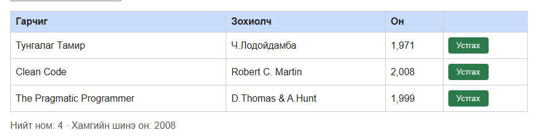
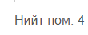

# BUG-01: «Нийт ном» тоолуур хүснэгтэд буй номын тооноос 1-ээр илүү харуулдаг

Орчин:  Уншлагын жагсаалт v2.0, Google Chrome, Windows 10 Pro (19045), 2026-10-20
Урьдчилсан нөхцөл: node app.js-ийг шинээр асаасан (анхны 3 ном)

## Дахин гаргах алхам
1. `node app.js` ажиллуулж, браузераар http://localhost:3000 нээнэ.
2. Хүснэгтэд буй номын мөрийг тоолно (3 ном: «Тунгалаг Тамир», «Clean Code», «The Pragmatic Programmer»).
3. Хүснэгтийн доор байрлах «Нийт ном» тоолуурыг харна.

Хүлээгдэж байсан: «Нийт ном: 3» — спецификаци: «"Нийт ном" тоолуур хүснэгтэд буй номын тоотой тэнцүү».
Бодит үр дүн:     «Нийт ном: 4 · Хамгийн шинэ он: 2008» гэж харагдана. Ном нэмэх, устгах бүрт тоолуур бодит тооноос үргэлж 1-ээр илүү байна.

Ноцтой байдал: Minor — өгөгдөл гэмтээхгүй ч хэрэглэгчид буруу мэдээлэл өгч, жагсаалтын бүрэн байдалд итгэх итгэлийг бууруулна.
Хавсралт:      screenshots/bug-01.png, screenshots/bug-01_1.png
Олдсон аялал:  Supermodel (GUI)

