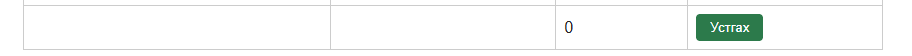
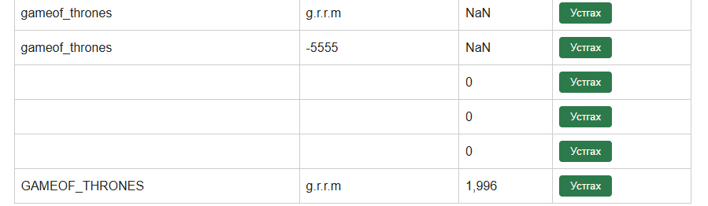

# BUG-02: Ном нэмэх маягт болон API хоосон / зөвхөн зайтай Гарчиг, Зохиолч, Он-г хүлээн авч ном нэмдэг

Орчин:  Уншлагын жагсаалт v2.0, Google Chrome, Windows 10 Pro (19045), curl 8.x, 2026-10-20
Урьдчилсан нөхцөл: node app.js-ийг шинээр асаасан (анхны 3 ном)

## Дахин гаргах алхам
UI:
1. http://localhost:3000 нээнэ.
2. Гарчиг, Зохиолч, Он гурван талбар тус бүрд зөвхөн нэг зай (space) бичнэ.
3. «Нэмэх» товчийг дарна.

API:
4. Дараах хүсэлтийг илгээнэ:
   ```
   curl -i -X POST localhost:3000/api/books -H "Content-Type: application/json" -d '{}'
   ```
   (Windows cmd: `{}`-ийг body.json-д хадгалаад `curl.exe -i -X POST http://localhost:3000/api/books -H "Content-Type: application/json" --data-binary "@body.json"`)
5. Мөн `{"title": "", "author": "", "year": ""}` болон `{"title": " ", "author": " ", "year": " "}` биеэр давтана.

Хүлээгдэж байсан: Ном нэмэгдэхгүй, ойлгомжтой алдааны мессеж харагдана; API 400 буцаана — спецификаци: «Гарчиг, Зохиолч, Он гурван талбар бүгд заавал бөглөгдсөн байх ёстой; дутуу бол ном нэмэгдэхгүй».
Бодит үр дүн:     UI-д «Ном нэмэгдлээ» мессеж гарч, Гарчиг, Зохиолч хоосон, Он «0» гэсэн мөр хүснэгтэд нэмэгдэнэ. API бүх тохиолдолд `HTTP/1.1 201 Created` `{"result":"OK","id":...}` буцааж, хоосон номыг хадгална.

Ноцтой байдал: Major — үндсэн баталгаажуулалтын дүрэм огт ажиллахгүй, утгагүй бичлэг өгөгдлийн санд хадгалагдана.
Хавсралт:      screenshots/bug-02.png, screenshots/bug-02_1.png, screenshots/bug-02_2.png · evidence/bug-02a-curl.txt (`{}`), evidence/bug-02b-curl.txt (хоосон string), evidence/bug-02c-curl.txt (зай)
Олдсон аялал:  Couch Potato (хоосон оролт); API хэсэг нь Saboteur




