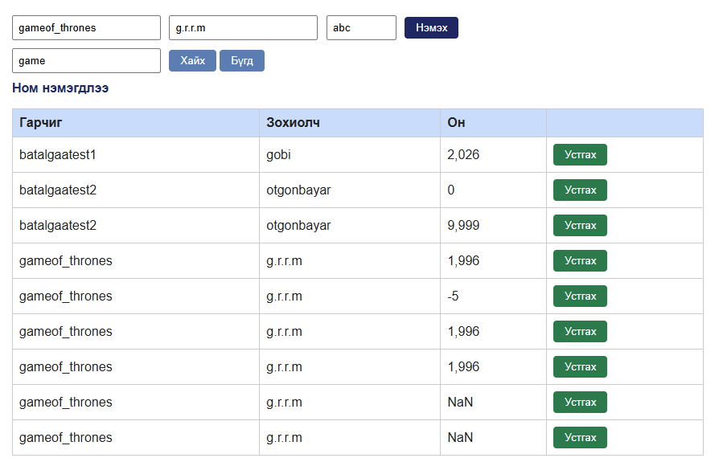
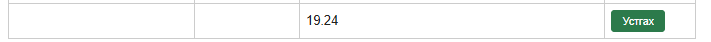

# BUG-03: Он талбар 1000-2100 хоорондох бүхэл тоо эсэхийг шалгадаггүй (үсэг, бутархай, хязгаараас гадуур утгыг хүлээн авдаг)

Орчин:  Уншлагын жагсаалт v2.0, Google Chrome, Windows 10 Pro (19045), curl 8.x, 2026-10-20
Урьдчилсан нөхцөл: node app.js-ийг шинээр асаасан (анхны 3 ном)

## Дахин гаргах алхам
1. http://localhost:3000 нээнэ.
2. Гарчиг: `Test`, Зохиолч: `Me`, Он: `abc` гэж бичээд «Нэмэх» дарна.
3. Гарчиг: `Test2`, Зохиолч: `Me`, Он: `19.24` гэж бичээд «Нэмэх» дарна.
4. Гарчиг: `Test3`, Зохиолч: `Me`, Он: `12345678` гэж бичээд «Нэмэх» дарна.
5. API-аар: `curl -i -X POST localhost:3000/api/books -H "Content-Type: application/json" -d '{"title": "Test", "author": "Me", "year": 12345678}'`

Хүлээгдэж байсан: Алхам бүрд ном нэмэгдэхгүй, алдааны мессеж гарна; API 400 буцаана — спецификаци: «Он нь 1000-2100 хоорондох бүхэл тоо».
Бодит үр дүн:     Гурван ном бүгд «Ном нэмэгдлээ» мессежтэйгээр нэмэгдэнэ. Хүснэгтэд он нь «NaN», «19.24», «12,345,678» гэж харагдана. API `HTTP/1.1 201 Created` буцааж, year 12345678, "abc", 1999.5 утгуудыг хадгална. (Мөн 0, -5, 9999 утга хүлээн авагдсан.)

Ноцтой байдал: Major — буруу өгөгдөл хадгалагдаж, «Хамгийн шинэ он» зэрэг тооцоо болон хүснэгтийн харагдацыг эвдэнэ.
Хавсралт:      screenshots/bug-03.png, bug-03_1.png … bug-03_5.png · evidence/bug-03a-curl.txt (12345678), evidence/bug-03b-curl.txt ("abc"), evidence/bug-03c-curl.txt (1999.5)
Олдсон аялал:  Couch Potato / хил хязгаарын утга (UI); API хэсэг нь Saboteur

