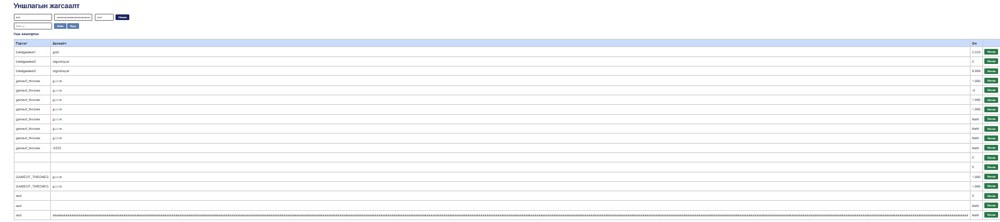
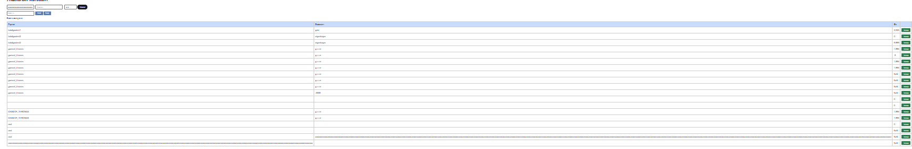

# BUG-05: Хэт урт Гарчиг/Зохиолч оруулахад хүснэгт дэлгэцээс хэтэрч эвдэрдэг

Орчин:  Уншлагын жагсаалт v2.0, Google Chrome, Windows 10 Pro (19045), 2026-10-20
Урьдчилсан нөхцөл: node app.js-ийг шинээр асаасан (анхны 3 ном)

## Дахин гаргах алхам
1. http://localhost:3000 нээнэ.
2. Гарчиг талбарт зайгүй 300 тэмдэгт `a` (aaaa...a) бичнэ, Зохиолч: `Me`, Он: `2000`.
3. «Нэмэх» дарна.

Хүлээгдэж байсан: Урт текст мөр дотроо таслагдах эсвэл хумигдаж, хүснэгт хуудасны өргөнд багтана — спецификаци: «хүснэгт ямар ч урттай оролтод эвдрэхгүй».
Бодит үр дүн:     Гарчиг багана хэт өргөсөж, хүснэгт дэлгэцийн өргөнөөс хэтэрнэ; бусад багана, «Устгах» товч баруун тийш шахагдаж, хуудсыг хэвтээ чиглэлд гүйлгэх шаардлагатай болно.

Ноцтой байдал: Minor — функц ажилласаар байгаа ч хүснэгтийг унших, Устгах товч дарахад хүндрэлтэй.
Хавсралт:      screenshots/bug-05.png, screenshots/bug-05_1.png
Олдсон аялал:  Supermodel (GUI)

