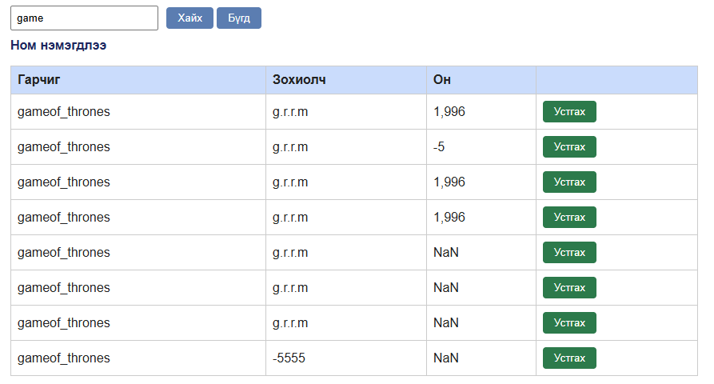

# BUG-07: Ижил гарчиг, зохиолчтой номыг давхардуулан нэмэх боломжтой

Орчин:  Уншлагын жагсаалт v2.0, Google Chrome, Windows 10 Pro (19045), curl 8.x, 2026-10-20
Урьдчилсан нөхцөл: node app.js-ийг шинээр асаасан (анхны 3 ном)

## Дахин гаргах алхам
1. http://localhost:3000 нээнэ.
2. Гарчиг: `Dup`, Зохиолч: `Me`, Он: `2000` гэж бичээд «Нэмэх» дарна.
3. Яг ижил утгаар 2-р алхмыг дахин давтана.
4. API-аар: `curl -i -X POST localhost:3000/api/books -H "Content-Type: application/json" -d '{"title": "Dup", "author": "Me", "year": 2000}'` хүсэлтийг 2 удаа илгээнэ.

Хүлээгдэж байсан: Хоёр дахь оролдлого татгалзагдаж, давхардлын тухай мессеж гарна; API 400/409 буцаана — спецификаци: «Ижил гарчиг, зохиолчтой ном давхардуулж нэмэгдэхгүй».
Бодит үр дүн:     Хоёр удаагийн нэмэлт бүгд амжилттай болж, хүснэгтэд ижил хоёр мөр харагдана. API хоёр хүсэлтэд хоёуланд нь `HTTP/1.1 201 Created` (id 50, 51) буцаасан.

Ноцтой байдал: Minor — давхардсан бичлэг жагсаалтыг бохирдуулж, «Нийт ном» тоог хиймлээр өсгөнө.
Хавсралт:      screenshots/bug-07.png · evidence/bug-07a-curl.txt, evidence/bug-07b-curl.txt
Олдсон аялал:  Saboteur (API); UI-д Couch Potato аялалын үеэр ижил ном олон удаа нэмэгдсэн

